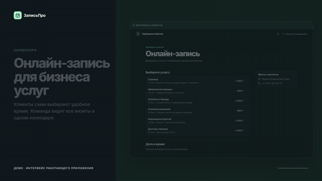
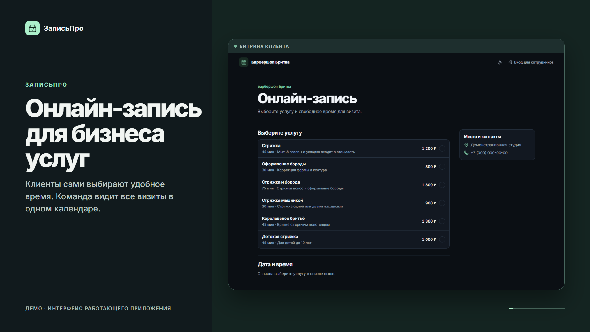
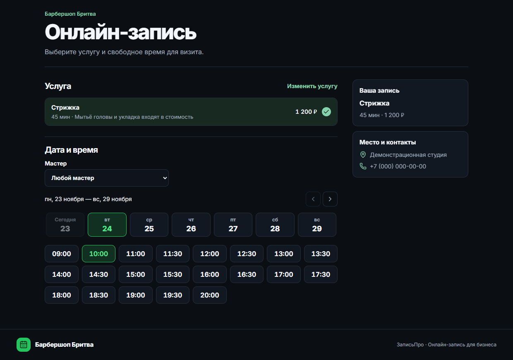
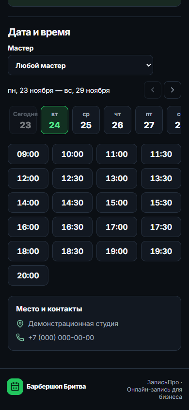
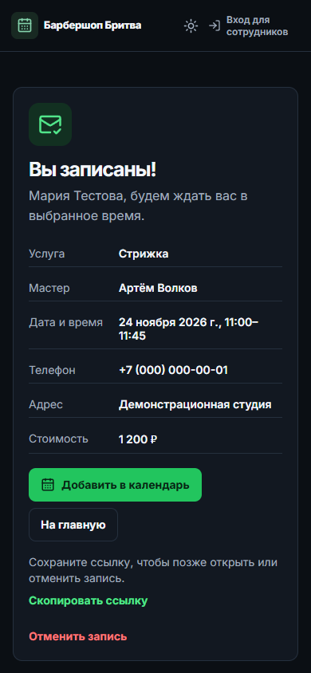
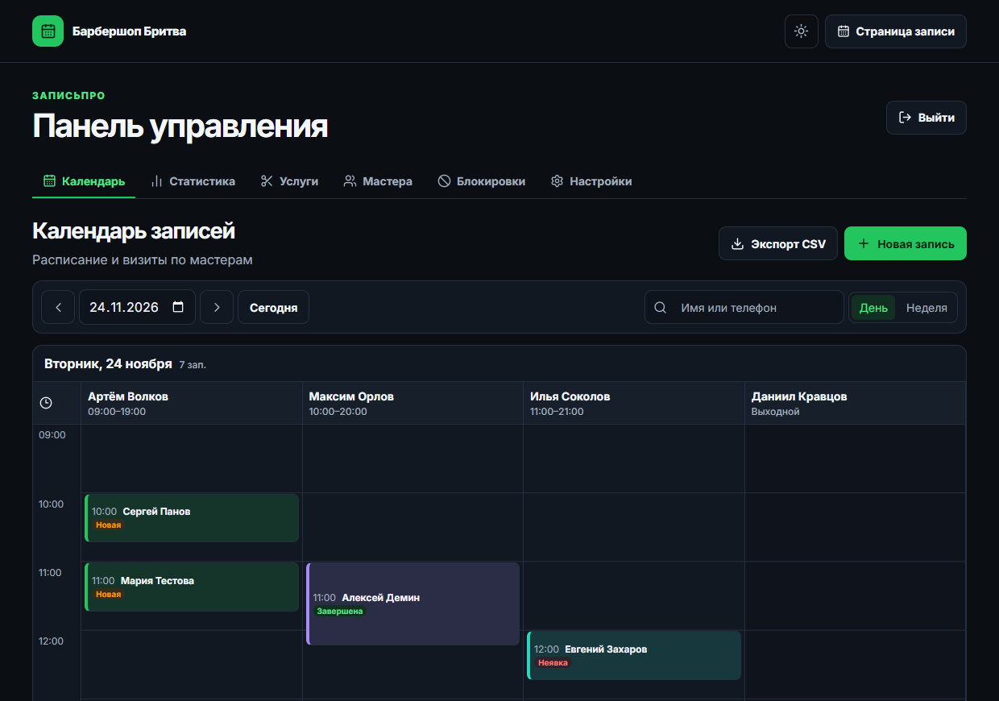

# ЗаписьПро

**Онлайн-запись для клиентов и календарь визитов для команды.**

---

## О проекте

«ЗаписьПро» — веб-приложение для бизнеса, который принимает клиентов по времени. Клиент выбирает услугу и свободный слот, а сотрудник получает запись в общем календаре. Для витрины я настроил демонстрационный барбершоп. Интерфейс также подходит для автосервиса, преподавателя и других услуг.

В ролике показан работающий интерфейс с тестовыми данными. В этом репозитории собраны видео, скриншоты и описание проекта.

## Видео

**[Смотреть онлайн со встроенным плеером](https://rostislav-565.github.io/zapis-pro-showcase/)**

[Открыть MP4](https://raw.githubusercontent.com/Rostislav-565/zapis-pro-showcase/main/videos/zapis-pro-promo-1920x1080.mp4) · 1920×1080, 32 секунды, без звука.

## Что показано

1. **Витрина клиента.** Список услуг с ценами и длительностью. После выбора услуги календарь сразу открывает ближайший свободный день.
2. **Запись с телефона.** Можно выбрать конкретного специалиста или время у любого из доступных. После подтверждения клиент может добавить визит в календарь или сохранить ссылку для отмены.
3. **Календарь сотрудников.** Визиты видны по специалистам и времени. В записи можно подтвердить визит или отметить его завершение.
4. **Статистика.** Выручка, загрузка специалистов и неявки за выбранный период. Записи можно выгрузить в CSV.

## Скриншоты

<table>
  <tr>
    <td></td>
    <td></td>
  </tr>
  <tr><td align="center">Свободное время</td><td align="center">Подтверждение</td></tr>
</table>

## Дизайн и технологии

Графитовый фон, мятный акцент и Inter с кириллицей. На мобильном интерактивная лента дат прокручивается внутри формы. Для интерфейса предусмотрены тёмная и светлая темы.

React 19 · Vite · TypeScript strict · Node.js 24 · SQLite. Доступность рассчитывается на сервере с учётом смен, перерывов и блокировок. Индекс и триггеры SQLite защищают от пересекающихся записей. Ролик собран из кадров реального приложения, снятых в Chrome.
